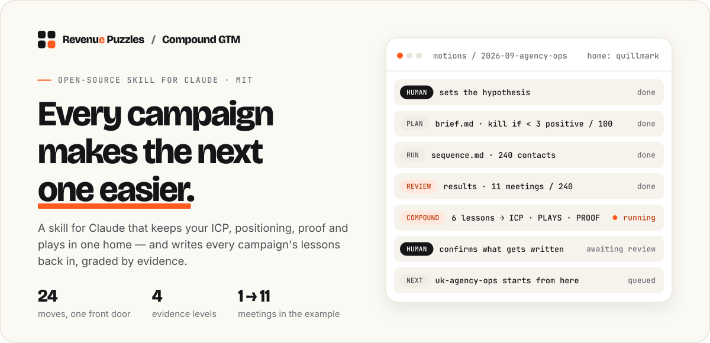
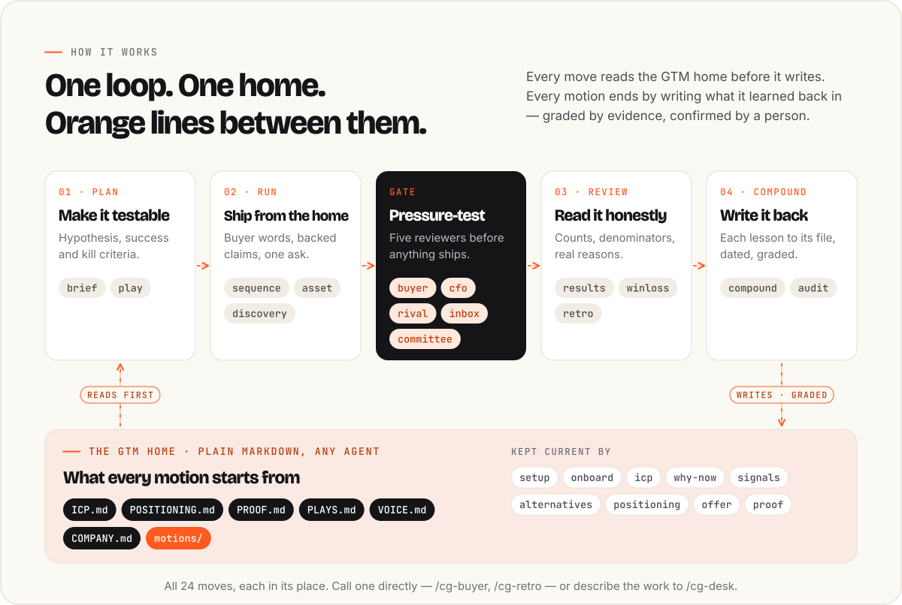
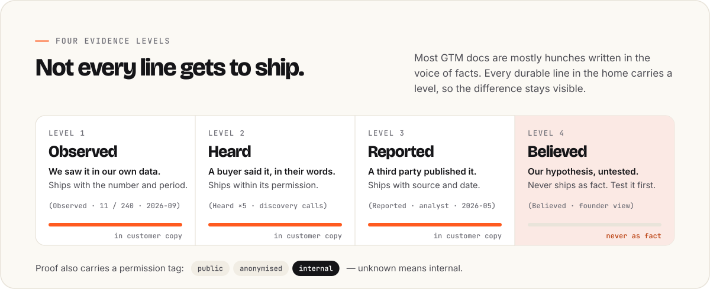
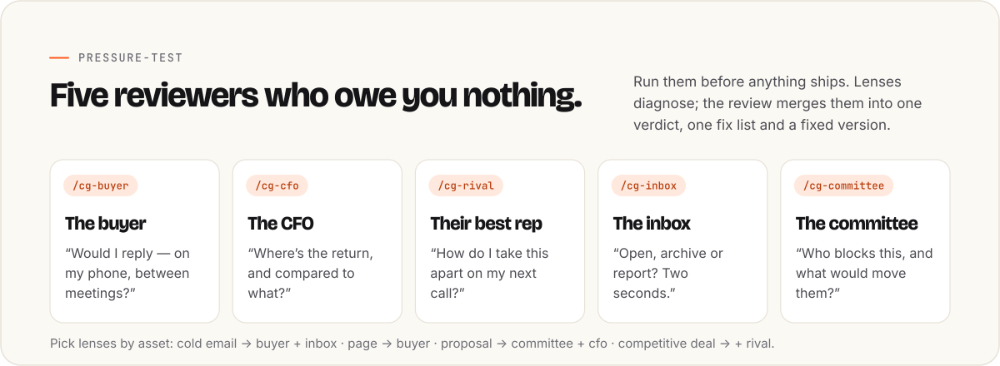
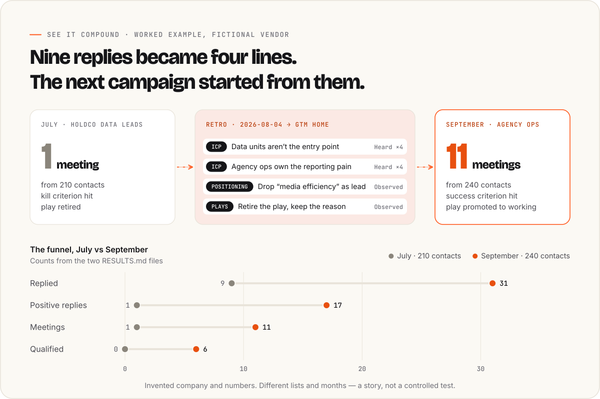

<p align="center">
  <a href="https://revenuepuzzles.com/?utm_source=github&utm_medium=readme&utm_campaign=compound-gtm&utm_content=hero">
    <picture>
      <source media="(prefers-color-scheme: dark)" srcset="assets/hero-dark.svg">
      
    </picture>
  </a>
</p>

<p align="center">
  <a href="#claude-claudeai-desktop-and-mobile"></a>
  <a href="#claude-code"></a>
  <a href="#the-toolbox"></a>
  <a href="LICENSE"></a>
  <a href="https://github.com/RevenuePuzzles/Compound-GTM/actions/workflows/build.yml"></a>
</p>

<p align="center">
  <b>A go-to-market toolbox for Claude where every campaign makes the next one easier.</b><br>
  Built by <a href="https://www.linkedin.com/in/emilkrzeminski/">Emil Krzemiński</a> at <a href="https://revenuepuzzles.com/?utm_source=github&utm_medium=readme&utm_campaign=compound-gtm&utm_content=byline">Revenue Puzzles</a>.
</p>

<p align="center">
  <a href="#install">Install</a> ·
  <a href="#how-it-works">How it works</a> ·
  <a href="#see-it-compound">See it compound</a> ·
  <a href="#the-toolbox">All 24 moves</a> ·
  <a href="#about-revenue-puzzles">Revenue Puzzles</a>
</p>

---

Most GTM work is forgotten a week after it ships. The replies, the objections, the real reason the deal was lost, the subject line that worked — they end up in Slack threads, CRM notes and one person's head. The next campaign starts from zero, and the AI writing it starts from less than zero: generic copy about "streamlining workflows" for a buyer it knows nothing about.

**Compound GTM fixes the memory, not the copy.** It keeps one **GTM home** — six plain Markdown files — and ends every motion by writing what was learned back into it, graded by how much evidence stands behind it. Sequences get written from what buyers actually said. Positioning gets rebuilt from real win/loss reasons. Plays get promoted only when the numbers earn it.

Most GTM skill packs are libraries of one-shot generators: write a cold email, build a persona. This is the layer underneath them — the memory that makes the next generation better than the last.

## Install

### Claude (claude.ai, desktop and mobile)

1. Download [`dist/compound-gtm.zip`](dist/compound-gtm.zip?raw=true).
2. Make sure code execution is on: **Settings → Capabilities** on Free, Pro and Max. On Team and Enterprise, an owner enables it under **Organization settings → Plugins & skills**.
3. Open **Customize → Skills**, click **+**, choose **Create skill → Upload a skill**, and pick the zip.
4. Start a chat: *"Help me plan our next outbound campaign"* or *"Read this email as a VP Finance at a holding company."*

Tip: keep your GTM home as files in a Claude Project so every chat starts from it.

### Claude Code

```
/plugin marketplace add RevenuePuzzles/Compound-GTM
/plugin install compound-gtm@compound-gtm
```

Then `/cg-desk` to start, or call any move directly: `/cg-buyer`, `/cg-winloss`, `/cg-compound`… The plugin adds about 1,000 tokens of always-on context; each move loads only when it runs.

### Other agents

The skill is a standard `SKILL.md` folder with plain-Markdown references. Point any agent that supports [Agent Skills](https://agentskills.io) at [`skills/compound-gtm/`](skills/compound-gtm/).

## How it works

<picture>
  <source media="(prefers-color-scheme: dark)" srcset="assets/loop-dark.svg">
  
</picture>

It's a map, not a gate. Start wherever you are — a draft to check, call notes to mine, a campaign to plan. The one habit it insists on: substantial work ends by offering the **compound** step, and nothing is written to the home until a person confirms it.

## The GTM home

```
gtm-home/
├── README.md         What this is and how to read a line — for teammates
├── ICP.md            Who buys, who doesn't, and what makes now the moment
├── POSITIONING.md    What buyers do instead of us, why we win, what we say
├── PROOF.md          Every claim we make — evidence, source, date, permission
├── PLAYS.md          What we run: testing → working → proven → retired
├── VOICE.md          How we sound, sentence by sentence
├── COMPANY.md        What we actually sell: offers, prices, terms, capacity
└── motions/
    └── 2026-10-outbound-holdco-cfos/
        ├── BRIEF.md      Hypothesis, success and kill criteria
        ├── assets/
        ├── RESULTS.md    Counts, not just rates
        └── RETRO.md      What happened, and what compounds
```

Plain files, so they work in a Git repo, a shared drive, Obsidian or a Claude Project — and any agent can read them. `create_home.py` scaffolds one without ever overwriting a file.

## Four evidence levels

<picture>
  <source media="(prefers-color-scheme: dark)" srcset="assets/evidence-dark.svg">
  
</picture>

Most GTM documents are mostly `Believed`, written in the confident voice of `Observed`. Compound GTM makes the difference visible, so the team knows which parts of its strategy are hunches. Every durable line carries a tag — `(Heard ×4 · discovery calls · 2026-09 · internal)` — and proof carries a permission, because most of the best B2B proof sits under NDA.

<details>
<summary>The same levels as a table</summary>

| Level | Meaning | In customer-facing copy? |
|---|---|---|
| **Observed** | We saw it in our own data | Yes, with the number and period |
| **Heard** | A buyer said it, in their words | Yes, within its permission |
| **Reported** | A third party published it | Yes, with source and date |
| **Believed** | Our hypothesis, untested | **No** — test it first |

</details>

## Pressure-test before it ships

<picture>
  <source media="(prefers-color-scheme: dark)" srcset="assets/lenses-dark.svg">
  
</picture>

Paste a draft and ask *"is this good?"*. The right lenses run, a claim check runs against your proof ledger, and you get one answer — not five stacked reports:

```
Verdict:            ship / fix first / rethink — the deciding reason
What the reader does: quoted line → reaction
Claims:             each one backed / weak / unverified / cut
Fix list:           ordered, deduplicated, each tied to the lens that found it
Fixed version:      the rewrite, with [NEEDS PROOF] wherever a claim lacks backing
```

## See it compound

<picture>
  <source media="(prefers-color-scheme: dark)" srcset="assets/story-dark.svg">
  
</picture>

[`examples/gtm-home/`](examples/gtm-home/) is a filled-in home for **Quillmark**, an invented measurement vendor selling to advertising holding companies, after three motions. Read [the July retro](examples/gtm-home/motions/2026-07-outbound-holdco-data-leads/RETRO.md) to watch a failed campaign turn into four lines in the home — then [the September results](examples/gtm-home/motions/2026-09-outbound-agency-ops/RESULTS.md) to see the campaign that started from them, and [the UK brief](examples/gtm-home/motions/2026-10-uk-agency-ops/BRIEF.md) to see how little the third one had to invent.

<details>
<summary>The chart's numbers as a table</summary>

| Stage | July · holdco data leads | September · agency ops |
|---|---|---|
| Reached | 210 | 240 |
| Replied | 9 | 31 |
| Positive reply | 1 | 17 |
| Meeting | 1 | 11 |
| Qualified | 0 | 6 |

Invented company and numbers. Different lists and months — a story about compounding, not a controlled test.

</details>

## The toolbox

One front door routes to 24 moves. You never have to learn the list: describe the work and it picks the smallest route.

### Common routes

- **Check a draft before it ships:** the right lenses for the asset + a claim check → one verdict, one fix list, a fixed version
- **New campaign:** `brief → play → sequence / asset → buyer + inbox → ship → results → retro → compound`
- **Positioning reset:** `signals → alternatives → positioning → proof → committee → compound`
- **Strategic deal:** `icp (fit check) → discovery → committee → cfo → winloss → compound`
- **New client, week one:** `setup → onboard → audit → icp → positioning`

<details>
<summary><b>All 24 moves, by group</b></summary>

**Home**

| Move | Job |
|---|---|
| `setup` | Create a GTM home without overwriting anything |
| `onboard` | Fill it from existing decks, calls and CRM exports — and show what's fact vs belief |
| `compound` | Write a confirmed lesson into the right file, dated and graded |
| `audit` | Check the home is still trustworthy: stale, contradictory, unproven, risky |

**Market**

| Move | Job |
|---|---|
| `icp` | Who buys, from closed deals first and opinions last — with disqualifiers |
| `why-now` | Triggers that open a buying window, and the signals that reveal them |
| `signals` | Mine calls, replies and reviews for buyer language, counted |
| `alternatives` | What buyers do instead — including doing nothing |

**Message**

| Move | Job |
|---|---|
| `positioning` | For whom, against what, proven how — and a message house teams can use |
| `offer` | An entry offer, a core and an expansion path people can say yes to |
| `proof` | Check every claim in a draft; build and anonymise case stories |

**Motion**

| Move | Job |
|---|---|
| `brief` | Make a campaign testable: hypothesis, success and kill criteria |
| `play` | Design the steps, owners, human approvals and tracking |
| `sequence` | Outbound and nurture that sound like a person, with reply branches |
| `asset` | Pages, one-pagers, posts, deck outlines, ads — built from proof |
| `discovery` | Questions that test hypotheses, and a capture template that feeds the home |

**Pressure-test**

| Move | Job |
|---|---|
| `buyer` | The target buyer's cold read: would I reply? |
| `cfo` | The economic buyer rebuilds your ROI math and finds the weakest assumption |
| `rival` | Your competitor's best rep takes your proposal apart |
| `inbox` | The two-second test: open, archive or report? |
| `committee` | The whole buying committee votes — and the likely blocker is named |

**Learn**

| Move | Job |
|---|---|
| `results` | Read the numbers honestly — counts, denominators, small-sample warnings |
| `winloss` | The real reasons deals were won or lost, beyond "price" |
| `retro` | Close out a motion and decide what compounds |

</details>

## Principles

1. **Memory over generation.** Writing the email is the easy part. Knowing what to say is the asset.
2. **Evidence over eloquence.** A confident sentence is not a fact. Grade it.
3. **Buyer words beat our words.** Verbatim language from calls outperforms anything invented.
4. **Small numbers are signals, not results.** Counts, denominators, periods — always.
5. **Humans own the strategy.** The moves push hard; they don't quietly replace your ICP or your price.
6. **Nothing goes live without approval.** No sending, publishing or CRM writes without a named human saying yes.
7. **Plain files, any agent.** The home outlives the tools.

See [ARCHITECTURE.md](ARCHITECTURE.md) for the full contract.

## About Revenue Puzzles

<p>
  <a href="https://revenuepuzzles.com/implementation/?utm_source=github&utm_medium=readme&utm_campaign=compound-gtm&utm_content=cta">
    
  </a>
</p>

[Revenue Puzzles](https://revenuepuzzles.com/?utm_source=github&utm_medium=readme&utm_campaign=compound-gtm&utm_content=about) is a GTM operating partner for B2B companies — sales, marketing and operations & product, run with a human + AI operating model: agents do the research, processing and execution, a person stays accountable for every decision. Compound GTM is how we keep client GTM knowledge from evaporating between campaigns, open-sourced.

- **Want it running inside your team?** The home built from your calls and CRM, the plays wired to your tools, agents doing the legwork and people making the calls — that's [Forward Deployed Implementation](https://revenuepuzzles.com/implementation/?utm_source=github&utm_medium=readme&utm_campaign=compound-gtm&utm_content=about).
- **Not sure where your GTM is leaking?** Start with a fixed-scope [GTM Audit](https://revenuepuzzles.com/?utm_source=github&utm_medium=readme&utm_campaign=compound-gtm&utm_content=audit#ways), or [book a 30-minute discovery call](https://revenuepuzzles.com/?utm_source=github&utm_medium=readme&utm_campaign=compound-gtm&utm_content=call#book).
- **More open playbooks and tools** from the same operating model:
  - [The Revenue Puzzles Playbook](https://revenuepuzzles.com/playbooks/revenue-puzzles/?utm_source=github&utm_medium=readme&utm_campaign=compound-gtm) — 240 puzzles across the whole B2B GTM lifecycle, from market choice to renewal.
  - [The RevOps Claude Playbook](https://revenuepuzzles.com/playbooks/revops-claude/?utm_source=github&utm_medium=readme&utm_campaign=compound-gtm) — a working Claude assistant for RevOps in a weekend, then the operating system that lasts.
  - [Maps of Content](https://revenuepuzzles.com/playbooks/maps-of-content/?utm_source=github&utm_medium=readme&utm_campaign=compound-gtm) — connect the sources behind a recurring decision, and route an agent through them.
  - [GTM brain](https://gtmpuzzles.com/) — a shared knowledge and context layer for GTM work that people and agents both read.
  - [All playbooks](https://revenuepuzzles.com/playbooks/?utm_source=github&utm_medium=readme&utm_campaign=compound-gtm) · [All tools](https://revenuepuzzles.com/tools/?utm_source=github&utm_medium=readme&utm_campaign=compound-gtm)

Follow [Emil on LinkedIn](https://www.linkedin.com/in/emilkrzeminski/) and [Revenue Puzzles on LinkedIn](https://www.linkedin.com/company/revenue-puzzles/) for what we learn running this with real teams. If Compound GTM saves you a campaign, a GitHub star helps other GTM teams find it.

## Repository

```
compound-gtm/
├── skills/compound-gtm/        The skill — the only source of truth
│   ├── SKILL.md                Front door and router
│   ├── references/
│   │   ├── context-contract.md
│   │   ├── evidence.md
│   │   ├── moves/              24 moves, one file each
│   │   └── templates/          Starter files for a home and a motion
│   └── scripts/create_home.py
├── commands/                   Generated /cg-* commands for Claude Code
├── examples/gtm-home/          A worked example (fictional)
├── dist/compound-gtm.zip       Built skill for claude.ai upload
├── assets/                     README visuals (generated)
├── scripts/build.py            Validates the skill, regenerates commands/ and dist/
├── scripts/render_assets.py    Regenerates assets/ from the example's own numbers
└── .claude-plugin/             Plugin and marketplace manifests
```

Edit the skill, then run `python scripts/build.py`. Never edit `commands/` or `dist/` by hand. CI runs `python scripts/build.py --check` on every push: frontmatter limits, routing coverage, manifest versions, links and generated files.

## Credits and license

MIT — see [LICENSE](LICENSE). Adapted for go-to-market from Every's [Compound Writing](https://github.com/EveryInc/compound-writing), also MIT; this project reuses its architecture ideas, not its text. Visuals use Bricolage Grotesque, Inter and JetBrains Mono (SIL Open Font License), drawn as paths.
